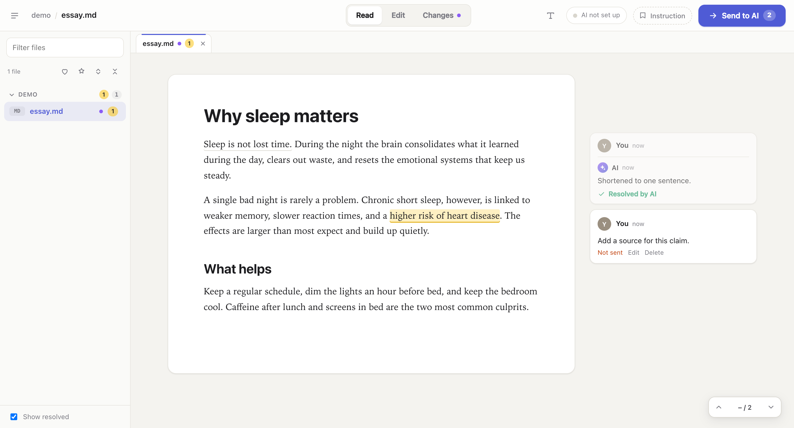
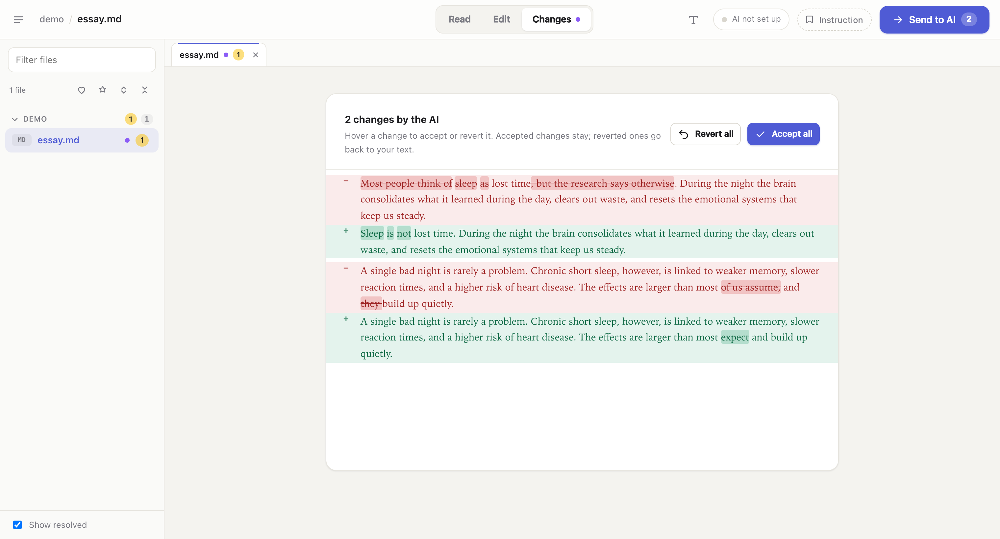

# Doc Review

Comment on documents like in Google Docs, then let AI handle your comments.
Works with `.md`, `.txt`, `.tex`. Free, open source, runs on your computer.





## Install

**Desktop app** (anyone): download from [Releases](https://github.com/MichaelEight/doc-review/releases/latest) (`.dmg` Mac, `.exe` Windows), open it, pick a folder.
The app is unsigned: on Mac right-click it → Open; on Windows click More info → Run anyway.

Then click **AI not set up** (top right) and paste an API key from
[OpenAI](https://platform.openai.com/api-keys), [Anthropic](https://console.anthropic.com/settings/keys)
or [OpenRouter](https://openrouter.ai/keys). Free alternative: [Ollama](https://ollama.com).
A ChatGPT/Claude chat subscription is not an API key.

**Claude Code / MCP** (needs Node 18+ and git):

```bash
git clone https://github.com/MichaelEight/doc-review.git ~/doc-review
claude mcp add --scope user doc-review -- node ~/doc-review/bin/doc-review.js --mcp
```

Other MCP clients: command `node`, args `["/full/path/doc-review/bin/doc-review.js", "--mcp"]`.
Then ask: "open this folder in doc-review".

## Use

1. Select text, click **Comment** (or click a spot, then **+**).
2. Press **Send to AI** (⌘⇧↵).
3. Review the edits in the **Changes** tab: Accept or Revert.

| Do | How |
|---|---|
| Find a file or phrase | ⌘K |
| Mention a file or tag | `@file`, `#tag` in a comment |
| Quick commands | Start a comment with `/fix`, `/simplify`, `/shorten`, `/translate <language>`, `/explain` |
| Same request on every comment | **Instruction** button next to Send |
| LaTeX preview | **PDF** tab (needs `pdflatex` installed) |

## Shortcuts

| Action | Mac | Windows |
|---|---|---|
| Send to AI | ⌘ ⇧ ↵ | Ctrl Shift Enter |
| Add comment on selection | ⌘ ⌥ M | Ctrl Alt M |
| Post reply | ⌘ ↵ | Ctrl Enter |
| Search files and text | ⌘ K | Ctrl K |
| Jump to heading | ⌘ ⇧ O | Ctrl Shift O |
| Previous / next comment | ⌥ , and ⌥ . | Alt , and Alt . |
| Switch tab 1–9 / close tab | ⌥ 1–9 / ⌥ W | Alt 1–9 / Alt W |
| Bold / italic / underline | ⌘ B / I / U | Ctrl B / I / U |
| Undo | ⌘ Z | Ctrl Z |

## Limits

- Not signed yet. No `.docx` yet.
- API key is saved in plain text in `~/.config/doc-review/ai.json` (only you can read it).
- Tested on macOS only.

MIT licence.
